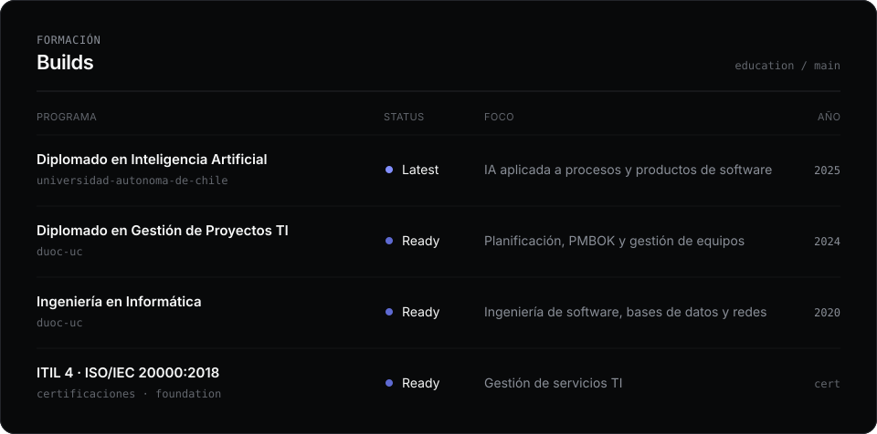

  

  

### Stack

   
  

También: SQL Server · SAP Business One · Service Layer · SAP HANA · Microsoft Graph · Qlik Sense · IIS · Proxmox · Hyper-V · Zabbix · Scrum · Kanban · PMBOK

### Contacto

